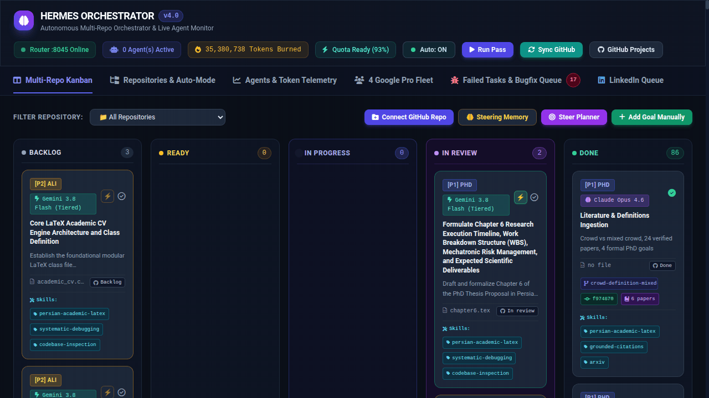
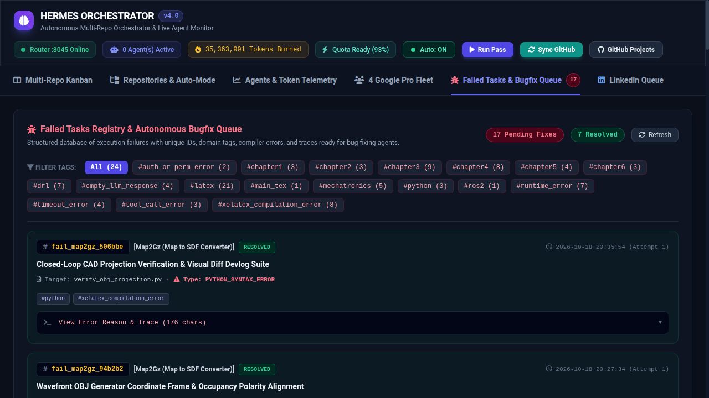
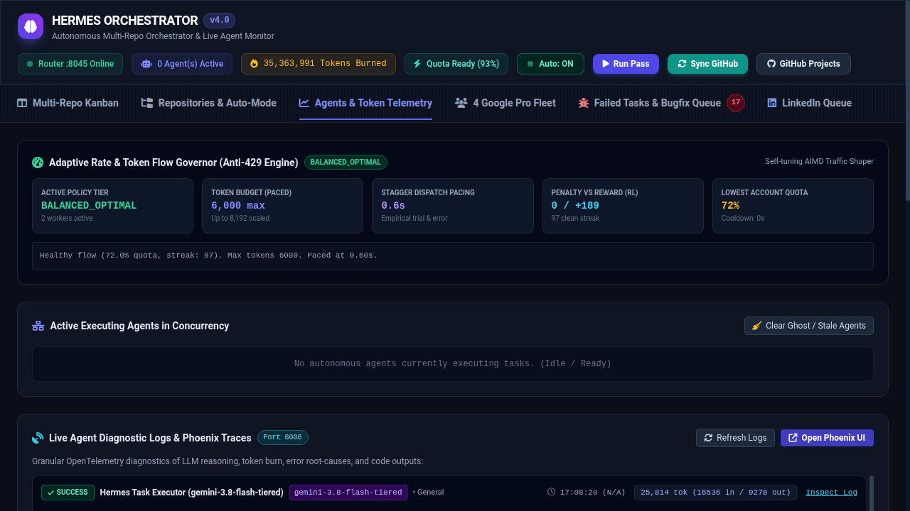
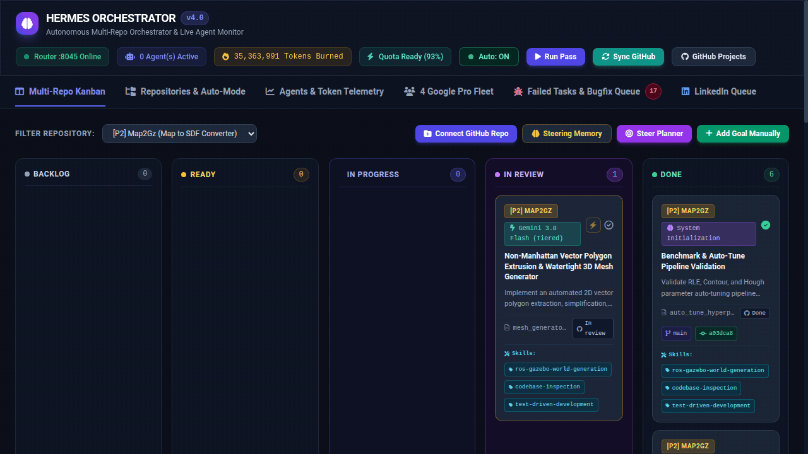

# 🚀 Hermes Orchestrator: Autonomous Multi-Repository AI Engineering Platform

<p align="center">
  
</p>

<p align="center">
  <a href="LICENSE"></a>
  <a href="https://www.python.org/"></a>
  <a href="https://phoenix.arize.com/"></a>
  <a href="https://github.com/"></a>
</p>

**Hermes Orchestrator** is an enterprise-grade autonomous software engineering and multi-repository orchestration platform. It connects a **Strategic Dual-Model Loop** (high-level cascading planner + parallel execution agents) with a modern **Web Cockpit UI**, **Arize Phoenix OpenTelemetry tracing**, and real-time **Two-Way Synchronization with GitHub Projects v2**.

---

## 🏛️ System Architecture

```text
┌─────────────────────────────────────────────────────────────────────────────┐
│                           HUMAN ARCHITECT (YOU)                             │
│                  Defines High-Level Direction & Ticks Approval              │
└──────────────────────────────────────┬──────────────────────────────────────┘
                                       │
                                       ▼
 ┌───────────────────────────────────────────────────────────────────────────┐
 │                    HERMES ORCHESTRATOR (Port :5050)                       │
 │  • Multi-Repo Kanban (Backlog, Ready, In Progress, In Review, Done)       │
 │  • Milestone Architect Studio (AI Refinement & Steering Memory)           │
 │  • 4-Account Token Quota Optimizer & Sensitive Rate Governor              │
 │  • Bugfix Queue & Circuit Breakers                                        │
 └─────────────────┬─────────────────────────────────────┬───────────────────┘
                   │                                     │
                   ▼ Two-Way GraphQL Sync                ▼ OpenTelemetry
 ┌───────────────────────────────────┐ ┌─────────────────────────────────────┐
 │       GitHub Projects v2          │ │     Arize Phoenix (Port :6006)      │
 │  • Backlog ➔ Ready ➔ In Prog ➔ Done│ │  • LLM Spans, Latency & Token Burn │
 │  • Real-time card state updates   │ │  • Explicit Red Error Spans         │
 └───────────────────────────────────┘ └─────────────────────────────────────┘
                   ▲                                     ▲
                   │                                     │
 ┌─────────────────┴─────────────────────────────────────┴───────────────────┐
 │               AUTONOMOUS ENGINE (autonomous_orchestrator.py)              │
 │                                                                           │
 │  1. Cascading Strategic Planner (Dynamic OpenRouter Ranking):             │
 │     • Claude Opus 4.6 Thinking / Sonnet 4.6 / Gemini 3.8 Flash Tiered     │
 │     • Synthesizes rigorous technical milestones into buffer pipeline      │
 │                                                                           │
 │  2. Human Approval Gate:                                                  │
 │     • AI Development proposals require user tick to enter execution queue │
 │     • Error recovery tasks execute automatically with recursive safety    │
 │                                                                           │
 │  3. Parallel Intra-Repo Workers:                                          │
 │     • ThreadPoolExecutor with rate-governed dispatch slot spacing         │
 │     • Thread-safe atomic Git commits with commit hash audit trail         │
 └───────────────────────────────────────────────────────────────────────────┘
```

---

## ✨ Key Capabilities

1. **Strategic Planner Cascade (Dynamic Model Ranking):**
   * Automatically queries live OpenRouter planning benchmarks to dispatch the highest-ranked available model (Claude Opus 4.6 Thinking, Sonnet 4.6, Gemini 3.8 Flash).
   * Seamlessly falls back to secondary models when quotas expire.
2. **Parallel Autonomous Execution Workers:**
   * Dispatches concurrent Hermes agents to work on independent target files simultaneously.
   * Protects code integrity via thread-safe atomic Git commits (`_GIT_LOCK`).
3. **Human-in-the-Loop ⚡ Approval Gate:**
   * AI-generated development plans land in the **Ready** column with a dedicated minimal `⚡` authorization badge.
   * Execution agents strictly skip unapproved plans until the human architect grants authorization (`⚡`).
   * Automated bugfix/recovery tasks execute immediately to unblock builds without manual intervention.
4. **Two-Way GitHub Projects v2 Synchronization (5-Column Kanban):**
   * Full GraphQL client pushes newly staged milestones, updates card descriptions, and automatically transitions status across `Backlog` ➔ `Ready` ➔ `In progress` ➔ `In review` ➔ `Done`.
5. **Interactive Learning Loop (3 AI Skills Tagged Per Task):**
   * Every generated milestone explicitly identifies the top 3 AI engineering skills and techniques required.
   * Fosters human-agent collaborative learning so developers understand how agents solve problems rather than treating them as black boxes.
6. **Continuous Sliding-Window Buffer & Self-Healing Reconciler:**
   * Dynamically replenishes active milestones to maintain a strict configurable cap (`milestone_cap`, default 3).
   * Automatically heals ghost/orphaned in-progress tasks on service reboot or process restart.
   <p align="center" style="margin-top: 10px;">
     
   </p>
7. **Observability & Telemetry (Arize Phoenix & OpenTelemetry):**
   * Emits standardized OpenInference LLM spans recording prompt tokens, completion tokens, reasoning tokens, and execution latencies.
   * 4-Account Token Quota Optimizer balances agent calls and prevents HTTP 429 rate limits.
   <p align="center" style="margin-top: 10px;">
     
   </p>
8. **Milestone Architect Studio & Negative Memory:**
   * In-app modal allows users to dictate or type raw thoughts, and uses AI to refine them into formal mathematical/code specifications.
   * Discarded tasks are stored in persistent blacklist memory (`architect_steering_history.json`) to prevent the planner from ever recreating them.
   <p align="center" style="margin-top: 10px;">
     
   </p>

---

## 🚀 Quick Start

### 1. Prerequisites
* **Linux / macOS** (Ubuntu 22.04+ recommended)
* **Python 3.10+**
* **Git** installed and configured
* (Optional) [Hermes Agent CLI](https://github.com/nousresearch/hermes-agent)

### 2. Installation
```bash
# Clone repository
git clone https://github.com/Ali-J-Fesharaki/hermes-orchestrator.git
cd hermes-orchestrator

# Create virtual environment
python3 -m venv .venv
source .venv/bin/activate

# Install dependencies
pip install -r requirements.txt
```

### 3. Configuration
Copy the sample environment file and configure your credentials:
```bash
cp .env.example .env
nano .env
```

| Key | Description | Required |
| :--- | :--- | :--- |
| `GITHUB_TOKEN` | GitHub Personal Access Token (requires `repo` and `project` scopes) | Optional (for GitHub Projects sync) |
| `HERMES_CUSTOM_ANTIGRAVITY_MANAGER_API_KEY` | API key for OpenRouter / LLM router | Optional |
| `ROUTER_URL` | Endpoint for OpenAI-compatible LLM router (`http://127.0.0.1:7836/v1`) | Optional |
| `TELEGRAM_BOT_TOKEN` | Bot token for quiet status updates | Optional |
| `TELEGRAM_CHAT_ID` | Telegram user ID for notifications | Optional |

### 4. Running the Web UI & Engine
```bash
# Start Hermes Orchestrator UI on http://localhost:5050
python3 control_center/server.py

# Or use the master runner script:
./run_automation.sh status      # Check system health, accounts & registered repos
./run_automation.sh loop        # Start continuous multi-repo orchestrator loop
./run_automation.sh planner     # Run a single strategic planning pass
./run_automation.sh executor    # Run prioritized execution workers on ready tasks
./run_automation.sh once        # Run one full planning & execution cycle
```

---

## 📋 Repository Registry

Target repositories are registered in `dashboards/repositories.json` (auto-initialized from `dashboards/repositories.example.json` if absent):

```json
{
  "id": "my_project",
  "name": "Autonomous Navigation Engine",
  "path": "/path/to/my_project",
  "category": "robotics-ros2",
  "priority": 1,
  "auto_planning": true,
  "milestone_cap": 3,
  "milestones": [
    {
      "name": "Scaffold: Core Safety Filter",
      "status": "todo",
      "details": "Implement Control Barrier Function (CBF) safety shielding.",
      "relative_filepath": "src/safety/cbf_filter.py",
      "approved_for_auto_run": false
    }
  ]
}
```

You can also attach repositories directly from the **Hermes Orchestrator Web UI** using the **`Connect GitHub Repo`** button.

---

## 🛠️ CLI Runner Commands

```text
Usage: ./run_automation.sh [command]

Commands:
  status               Show active router service, accounts, quotas, and registered tasks
  loop                 Continuous multi-repo orchestrator (Worker + Roving Planner)
  planner              Run a strategic planning audit pass across all repositories
  executor             Run prioritized execution worker on pending milestones
  once                 Execute a single pass across repositories and exit
  notes                Launch live auto-updating sticky notes on Desktop
  boards               Update & render the Control Tower Dashboards
```

---

## 📄 License

This project is licensed under the **MIT License** — see the [LICENSE](LICENSE) file for details.

Developed by **Ali Jafari Fesharaki** as part of Advanced Autonomous Multi-Agent Engineering Systems.
